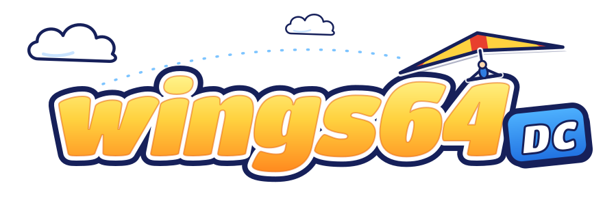

<p align="center">
  
</p>

<p align="center">
  <a href="https://github.com/TechProGabe/wings64-dc/actions/workflows/checks.yml"></a>
  
  
  
  
  
  
</p>

Pilotwings 64, running natively on a Sega Dreamcast. No emulator: the game's own code, rebuilt for the SH-4.

I wanted to see if the N64's gentlest flight sim could fly on Sega's last console. It can. Still a work in progress, so expect the odd bug.

## What it is

The Pilotwings 64 matching decompilation ([gcsmith/Pilotwings64Decomp](https://github.com/gcsmith/Pilotwings64Decomp)) built with [KallistiOS](https://github.com/KallistiOS/KallistiOS) and the [sh4zam](https://github.com/TechProGabe/sh4zam) SH-4 math library. The game's N64 display lists are interpreted on the CPU and handed to the PowerVR, and its own music and sound players drive the Dreamcast's AICA sound chip. It targets a stock retail console with 16 MB of RAM and builds a `.cdi` you can burn to a CD-R.

## Building it

This repo has no game data in it, and never will. You need your own legally obtained North American N64 ROM (checksums in `docs/rom-provenance.md`) saved as `baserom.z64` at the repo root. Assets are extracted from it at build time. Please don't share the disc images you build, they contain the game.

You need Docker (colima works on macOS).

```
./run.sh setup     # builds the toolchain container (about an hour the first time) and fetches the decomp
./run.sh disc      # build/wings64.cdi, padded for a CD-R
./run.sh gate      # boots a scripted build in Flycast and checks it reaches the milestone
./run.sh test      # tree checks and host tests
```

`docs/toolchain.md` and `kb/RESUME.md` have the rest of the commands.

## A few things that make this fun

- The decomp is never edited. It gets fetched at a pinned revision and patched from `patches/`, one patch per reason.
- All the float math goes through sh4zam. No doubles anywhere.
- The biggest speed win was not clever SH-4 code. The game's idle loop was getting the CPU on every scheduler tick, and parking it doubled the frame rate.
- The N64 draws its vehicle shadows with a z-buffer trick. On the Dreamcast they become PowerVR modifier volumes, the hardware's own shadow feature.
- Emulator numbers and console numbers live in separate columns. Flycast once said 30 fps while the real console was doing 15.

## Thanks

This port stands on a lot of other people's work:

- **[Pilotwings64Decomp](https://github.com/gcsmith/Pilotwings64Decomp)** by Garrett Smith and contributors (MIT). The whole game, as C. Without it there is no port.
- **[Birdman64](https://github.com/NoahVl/Birdman64)** by NoahVl (MIT). A PC port of the same decomp. It showed me what this game needs from the N64's OS, and several of its fixes are in `patches/`.
- **[sm64-dc](https://github.com/jnmartin84/sm64-dc), [sf64-dc](https://github.com/jnmartin84/sf64-dc) and [mk64-dc](https://github.com/jnmartin84/mk64-dc)** by jnmartin84. The blueprint for turning N64 display lists into PowerVR draws and N64 audio into AICA voices.
- **[ssb64-dc](https://github.com/beigeceleron/ssb64-dc)** by beigeceleron. The model for the repo layout, build and disc pipeline.
- **[KallistiOS](https://github.com/KallistiOS/KallistiOS)**, the Dreamcast dev kit everything runs on.
- **[sh4zam](https://github.com/gyrovorbis/sh4zam)** by Falco Girgis and contributors (MIT). All the fast SH-4 math.
- **[Flycast](https://github.com/flyinghead/flycast)**, which does most of my testing, and **[mkdcdisc](https://gitlab.com/simulant/mkdcdisc)**, which makes the disc images.

Pilotwings 64 belongs to Nintendo and Paradigm. This is an unofficial fan project.
